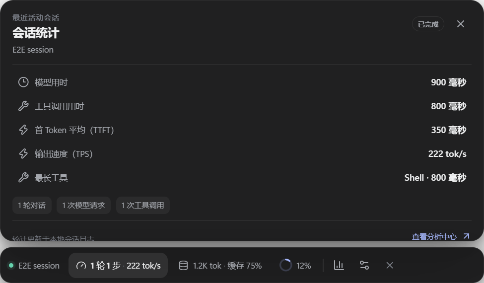
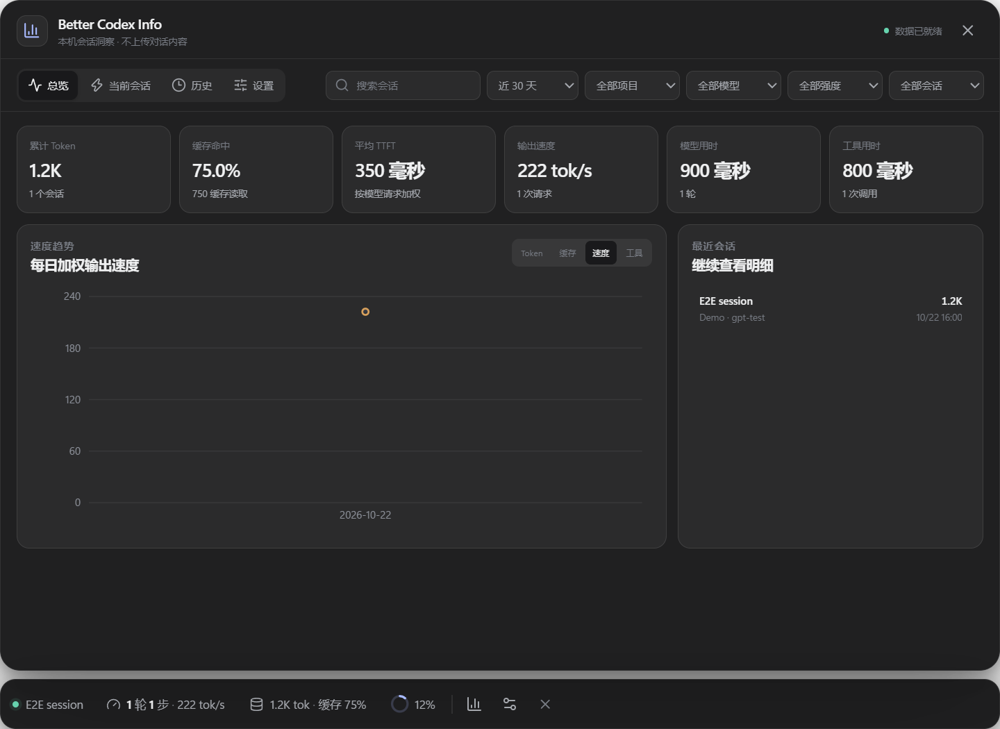
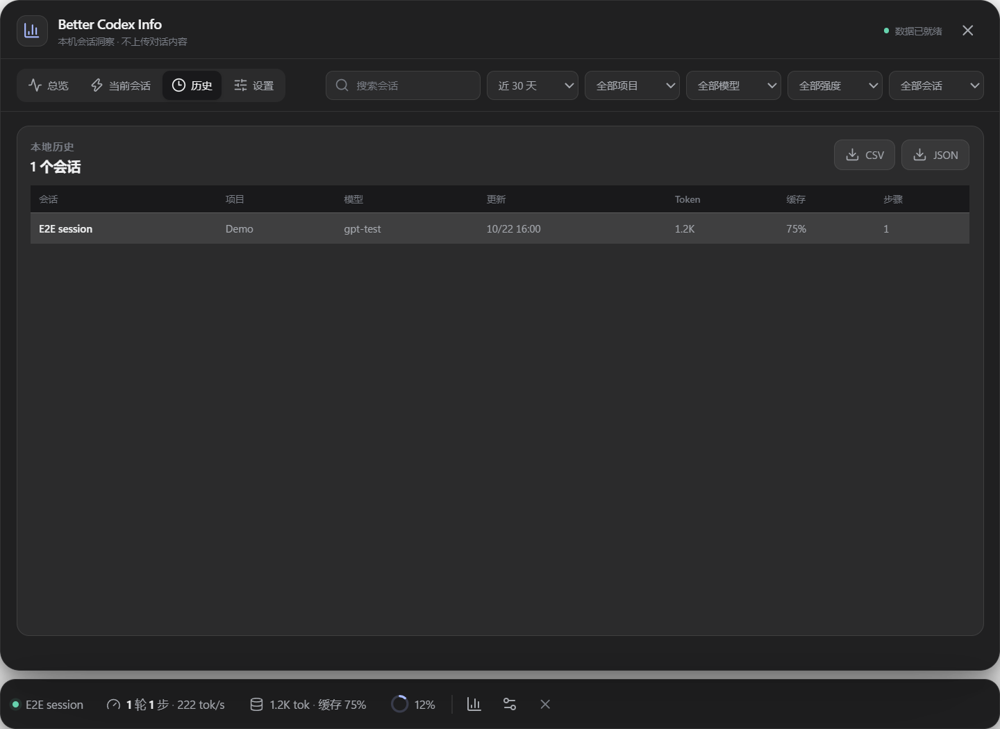

# Better Codex Info

Better Codex Info 是一个本地优先的 Codex 会话分析伴随层。它在 Codex 输入框底部显示轮次、Token、缓存命中、输出速度和上下文占用，并可在原地展开完整的会话与历史分析面板。

应用不会修改 Codex 安装包，不会读取 OAuth 凭据，也不会发送会话数据到网络。







## 功能

- 三枚实时胶囊：`轮次 / 步骤 / TPS`、`Token / 缓存命中`、`上下文占用`。
- 会话统计：模型用时、工具用时、平均 TTFT、输出 TPS 和最长工具调用。
- Token 用量：输入、缓存读取、未缓存输入、缓存写入、输出和推理输出。
- 上下文构成：系统指令、工具定义、对话消息和其他预留空间的近似分布。
- 分析中心：历史趋势、会话筛选、逐轮明细、工具耗时、Token 预算提醒。
- CSV / JSON 导出，默认不包含消息正文、命令参数或工具输出。
- Windows 与 macOS 悬浮窗口、托盘菜单、主题和开机启动设置。

## 数据口径

| 指标 | 口径 |
| --- | --- |
| 轮次 | 用户任务轮次 |
| 步骤 | 模型请求次数 |
| 会话 Token | Codex 最近一次累计 Token 快照 |
| 上下文占用 | 最近一次模型请求的输入 + 输出 Token |
| 缓存命中率 | `cached_input / input` |
| 模型用时 | 推理与回复条目时间区间的并集 |
| 工具用时 | 工具条目时间区间的并集 |
| TPS | 输出 Token / 模型生成区间 |
| TTFT | 优先使用 `task_complete.time_to_first_token_ms`，缺失时用首条回复时间估算 |

上下文构成与部分旧会话的 TTFT 是近似值，界面会明确标注。成本、订阅积分和账户余额不在本项目范围内。

## 本地开发

环境要求：Node.js 22+、pnpm 11+。

```powershell
pnpm install
pnpm dev
```

正常启动后，应用会读取：

- `CODEX_HOME`（默认 `~/.codex`）下的 `sessions/` 与 `archived_sessions/`
- `state_*.sqlite`、`thread_history_*.sqlite`（只读）
- 应用自己的指标缓存：Windows 为 `%APPDATA%/Better Codex Info/metrics.sqlite3`，macOS 为 `~/Library/Application Support/Better Codex Info/metrics.sqlite3`

开发时如果 Codex 不在前台，悬浮层会自动隐藏。可通过托盘图标重新显示。

## 验证

```powershell
pnpm run typecheck
pnpm test
pnpm run build
pnpm run test:e2e
```

端到端测试使用临时 Codex 数据目录，不读取真实会话。成功时会生成 `test-results/analysis-center.png`。

## 打包

```powershell
pnpm run dist:win
pnpm run dist:mac
```

Windows 生成 NSIS 安装包。macOS 生成 x64 与 arm64 的 DMG/ZIP；没有 Developer ID 证书时产物未签名，正式分发前需要完成签名和公证。

## 已知限制

- Codex 不会持久化“当前仅浏览的会话 ID”，因此胶囊跟随最近产生新事件的主会话。展开历史列表可固定任意会话。
- 系统提示词和工具 schema 的精确分词由服务端决定，本项目只做归一化估算。
- 云端会话、已删除会话和未写入本机的历史数据无法分析。
- macOS 无法读取 Codex 窗口边界时不申请屏幕录制权限，会退化为使用持久化窗口位置。

## 隐私

- 不包含遥测、崩溃上报或远程请求。
- 只向自有 SQLite 写入指标、标题、工作目录、模型与工具类别。
- 消息正文仅在内存中用于长度估算，不落盘。

## License

MIT
